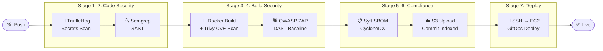
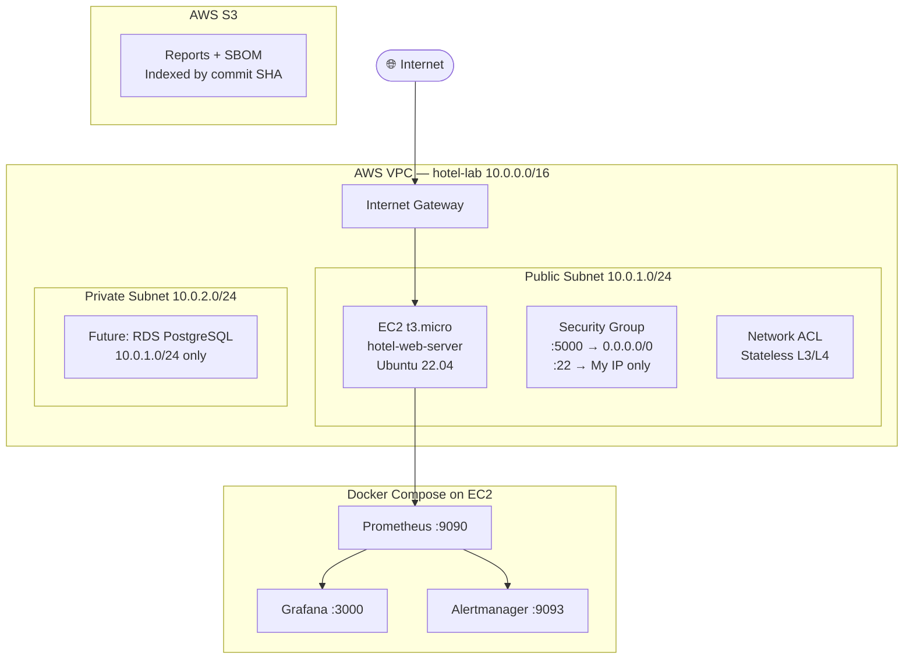
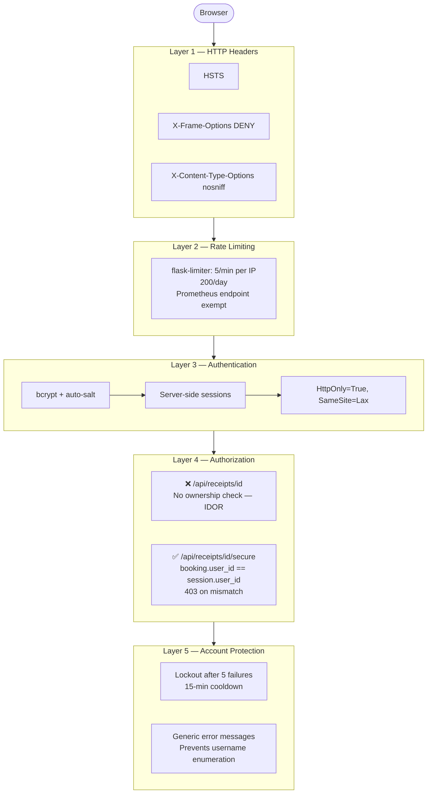

<div align="center">

#  Hotel Security App

**A deliberately vulnerable Flask hotel booking application secured end-to-end —**  
**from OWASP Top 10 remediations to a 7-stage CI/CD security pipeline, AWS cloud infrastructure, and production observability stack.**

[](https://python.org)
[](https://flask.palletsprojects.com)
[](https://docker.com)
[](https://aws.amazon.com)
[](https://terraform.io)
[](https://github.com/features/actions)

| Metric | Result |
|--------|--------|
|  Pipeline Stages | **7 automated security gates** |
|  CVE Reduction | **177 → 2 (98% via Alpine Docker)** |
|  MTTD | **< 60 seconds** |
|  OWASP ZAP | **55 PASS / 0 FAIL** |
|  IaC Resources | **8 Terraform-managed AWS resources** |

[**📖 Blog Series**](https://jsec-dev.hashnode.dev) · [**💼 LinkedIn**](https://linkedin.com/in/jonathan-crowder-390b2430a)

</div>

---

##  What Business Problem Does This Solve?

| # | Problem | Solution Built | Impact |
|---|---------|---------------|--------|
| 1 | Vulnerabilities reaching production | 7-stage automated pipeline blocks on secrets, CVEs, SAST, DAST | Average breach cost: $4.45M (IBM 2023) |
| 2 | Manual deployments are unauditable | GitOps — all changes via PR, deployed only after all gates pass | Full audit trail, zero manual SSH to prod |
| 3 | No software dependency inventory | Syft generates CycloneDX SBOM per commit, stored in S3 | EO 14028 compliance; Log4Shell-style response in seconds |
| 4 | Infrastructure drift between environments | Terraform IaC for all 8 AWS resources | Identical environments; one-command disaster recovery |
| 5 | Outages discovered by customers | Prometheus + Grafana + Alertmanager with AppDown alert | MTTD reduced from hours to < 60 seconds |

---

##  Architecture

### 7-Stage CI/CD Security Pipeline



### AWS Network Topology — Zero-Trust Design



### Application Security — Defense in Depth



---

##  Security Implementations — OWASP Top 10

<details>
<summary><strong>Week 1 — A03: Injection / XSS</strong></summary>

- Demonstrated `innerHTML` XSS vulnerability in hotel feedback form
- Fixed with `textContent` — browser treats value as text, not markup
- Manual SAST via `grep` for dangerous patterns

</details>

<details>
<summary><strong>Week 2 — A05: Security Misconfiguration (Clickjacking, CSS Exfil, SRI)</strong></summary>

- Built: iframe overlay clickjacking attack
- Built: CSS attribute selector exfiltration of input values
- Fixed: `X-Frame-Options: DENY`, `Content-Security-Policy: default-src 'self'`, Subresource Integrity SHA-384 hashes

</details>

<details>
<summary><strong>Week 3 — A07: Broken Authentication</strong></summary>

- bcrypt with auto-generated salt (never `md5()` or plaintext)
- Server-side sessions with filesystem store
- `HttpOnly=True`, `SameSite=Lax` cookies
- `flask-limiter`: 5 req/min per IP (rate limiting)
- Account lockout: 5 failures → 15-min lockout (`failed_attempts`, `locked_until` columns)
- Generic error messages — no username enumeration

</details>

<details>
<summary><strong>Week 4 — A01: Broken Access Control (IDOR)</strong></summary>

Demonstrated: Logged in as User 4, accessed User 2's $1,299 receipt via `GET /api/receipts/2` — no auth check.

```python
# ❌ Vulnerable
@app.route('/api/receipts/<int:booking_id>')
def get_receipt(booking_id):
    booking = get_booking(booking_id)  # no ownership check
    return jsonify(booking)

# ✅ Secure
@app.route('/api/receipts/<int:booking_id>/secure')
def get_receipt_secure(booking_id):
    booking = get_booking(booking_id)
    if booking['user_id'] != session['user_id']:
        return jsonify({'error': 'Access denied'}), 403
    return jsonify(booking)
```

</details>

<details>
<summary><strong>Week 6 — A05: SAST with Semgrep</strong></summary>

- Scanned with `p/python`, `p/flask`, `p/secrets` rulesets
- Blocked: `debug=True` in production (auto-detected, fixed)
- Documented false positive: `host='0.0.0.0'` with `# nosemgrep` + written justification
- 202 rules scanned, 1 finding resolved

</details>

<details>
<summary><strong>Week 7 — A02: Secrets Management</strong></summary>

- TruffleHog v3 detected intentionally committed Stripe key in Git history
- Fixed: `.env` + `python-dotenv`, `.env.example` pattern
- Pipeline configured with `--only-verified` flag (eliminates false positives)
- GitHub push protection blocks new secrets at commit time

</details>

<details>
<summary><strong>Week 8 — A06: Container Security</strong></summary>

| Image | Size | HIGH CVEs | CRITICAL CVEs |
|-------|------|-----------|---------------|
| `python:3.11` (Ubuntu) | 689 MB | 140 | 37 |
| `python:3.11-alpine` | 175 MB | 2 | 0 |

- Non-root user in Dockerfile
- `.dockerignore` excludes `.env`, `*.pyc`, `__pycache__`
- Trivy scan integrated into CI pipeline — blocks on CRITICAL severity

</details>

<details>
<summary><strong>Weeks 9–11 — Zero-Trust AWS Infrastructure</strong></summary>

- VPC with public/private subnet isolation
- Security Groups (stateful, L4) + Network ACLs (stateless, L3/L4)
- SSH key authentication only — `PermitRootLogin disabled`
- IAM least-privilege user for Terraform
- All 8 resources defined as Terraform IaC — no console clicks

</details>

<details>
<summary><strong>Week 15 — Security Observability</strong></summary>

```yaml
# Real Prometheus metrics from production
flask_http_request_total{method="POST",status="429"} 16.0  # rate-limited brute force
flask_http_request_total{method="GET",status="429"} 39.0   # monitoring blindness bug
```

**Bug found and fixed**: Rate limiter was blocking Prometheus scraping (`/metrics` → 429). Fixed with custom `key_func` exempting EC2 internal IP.

Alertmanager rules:
- `AppDown`: app unreachable for 60s
- `HighErrorRate`: error rate > 10% over 5 min
- `HighLoginFailures`: > 0.5 failed logins/sec sustained 1 min

</details>

---

##  Tech Stack

| Category | Technology |
|----------|-----------|
| **Application** | Python 3.11, Flask, SQLite |
| **Auth & Security** | bcrypt, flask-limiter, flask-session |
| **Containers** | Docker Alpine, Docker Compose |
| **CI/CD** | GitHub Actions, appleboy/ssh-action |
| **Cloud** | AWS EC2, VPC, S3, IAM |
| **IaC** | Terraform (HCL) |
| **Secrets Detection** | TruffleHog v3 |
| **SAST** | Semgrep (p/python, p/flask) |
| **Container CVE Scan** | Trivy |
| **DAST** | OWASP ZAP Baseline |
| **SBOM** | Syft (CycloneDX JSON format) |
| **Metrics** | Prometheus + Flask Prometheus Exporter |
| **Dashboards** | Grafana |
| **Alerting** | Alertmanager → Slack |

---

##  Project Structure

```
hotel-security-app/
├── app.py                    # Flask application (IDOR demo + secure endpoints)
├── Dockerfile                # Alpine-based, non-root user
├── docker-compose.yml        # App + observability stack
├── requirements.txt
├── terraform/
│   ├── main.tf               # VPC, subnets, IGW, route table
│   ├── ec2.tf                # EC2 instance + security group
│   └── variables.tf
├── monitoring/
│   ├── prometheus.yml        # Scrape config + alert rules
│   ├── alertmanager.yml      # Slack webhook (gitignored)
│   └── grafana/
│       └── dashboards/
├── .github/
│   └── workflows/
│       └── security-pipeline.yml   # 7-stage pipeline
└── .gitignore                # .env, *.tfvars, alertmanager.yml
```

---

##  Running Locally

```bash
# Clone
git clone https://github.com/cyberl3gend/hotel-security-app
cd hotel-security-app

# Set environment variables
cp .env.example .env
# Edit .env with your SECRET_KEY

# Run with Docker
docker build -t hotel-security-app .
docker run -p 5000:5000 hotel-security-app

# Or run the full observability stack
docker-compose up -d

# Test IDOR vulnerability
curl http://localhost:5000/api/receipts/2          # ❌ returns any user's receipt
curl http://localhost:5000/api/receipts/2/secure   # ✅ 403 if not your booking
```

---

##  CI/CD Pipeline Output

```
✅ Stage 1: TruffleHog — 0 verified secrets found
✅ Stage 2: Semgrep     — 0 blocking findings (202 rules scanned)
✅ Stage 3: Docker Build — Successfully built hotel-security-app:alpine
✅ Stage 4: Trivy       — 2 HIGH, 0 CRITICAL (alpine base)
✅ Stage 5: OWASP ZAP  — 55 PASS, 12 WARN, 0 FAIL
✅ Stage 6: Syft SBOM  — CycloneDX JSON uploaded to S3
✅ Stage 7: Deploy      — Deployed to EC2 via SSH GitOps
```

---

##  Blog Series

Each implementation is documented with the vulnerability, exploitation steps, and remediation:

- [Week 1: XSS and the innerHTML Trap](https://jsec-dev.hashnode.dev)
- [Week 3: Building Secure Auth from Scratch](https://jsec-dev.hashnode.dev)
- [Week 4: IDOR — How One Missing Check Exposes Every User](https://jsec-dev.hashnode.dev)
- [Week 8: 177 CVEs to 2 with One Dockerfile Change](https://jsec-dev.hashnode.dev)
- [Week 13: Building a 7-Stage Security Pipeline](https://jsec-dev.hashnode.dev)

---

## 👤 About

**Jonathan Crowder**  
B.S./M.S. Cybersecurity (Fast-Track) · St. John's University · GPA 3.92  

This project was built over 16 weeks as a structured DevSecOps sprint — every component built from first principles, every vulnerability exploited before it was fixed, and every fix documented publicly.

[](https://linkedin.com/in/jonathan-crowder-390b2430a)
[](https://jsec-dev.hashnode.dev)
[](https://github.com/cyberl3gend)

---

<div align="center">
<sub>Built with intention. Secured with evidence. Documented for impact.</sub>
</div>
